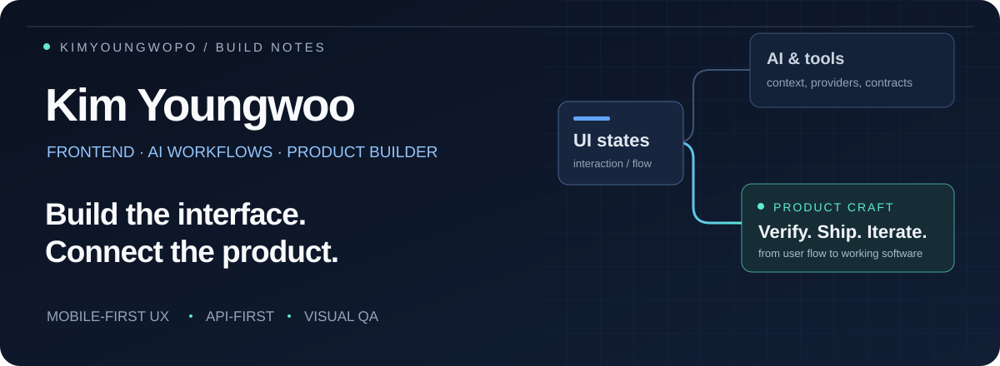
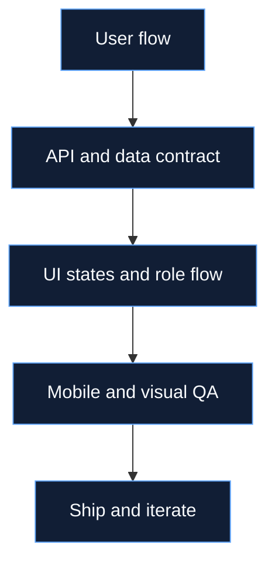

  

  <strong>프론트엔드와 AI 워크플로를 연결해, 실제로 쓰이는 제품을 만듭니다.</strong> 
  Product UI · AI Agent Skills · Generative Media · Verified Workflows

  
  
  

---

## 01 / Featured Build

### Frameflow

**AI 이미지 생성·편집을 연결하고, 결과를 검증하는 로컬 스튜디오.**

이미지 생성·편집을 노드 그래프로 구성하고, Local Bridge와 provider adapter로 연결합니다. 모션 아틀라스 검증 → 정확한 프레임 분리 → GIF/APNG 출력까지 명확한 계약으로 다룹니다.

`Next.js` · `TypeScript` · `Local-first` · `Apache-2.0`

[**Explore repository →**](https://github.com/kimyoungwopo/frameflow) · [한국어 가이드](https://github.com/kimyoungwopo/frameflow/blob/main/README.ko.md)

---

## 02 / Open-source Toolkit

### Cafe24 Smart Design
**카페24 스킨 작업을 위한 검색 가능한 레퍼런스.**

모듈·변수·수정자, JSON registry, 공식 문서 맵과 AI 편집 guardrail을 정리합니다. 공개 뷰어에서 탐색하고 데이터 검증으로 정합성을 확인합니다.

[Repository](https://github.com/kimyoungwopo/cafe24-smart-design) · [**Live docs →**](https://kimyoungwopo.github.io/cafe24-smart-design) · `HTML` · `MIT`

### Frontend Token Trim Skillpack
**구현에 필요한 맥락은 남기고, 불필요한 컨텍스트는 줄이는 도구.**

Ponytail · Graphify · Headroom 기반으로 Hermes Agent의 프론트엔드 구현과 QA 흐름을 정리합니다.

[**Repository →**](https://github.com/kimyoungwopo/frontend-token-trim-skillpack) · `Hermes Agent` · `Skillpack` · `MIT`

### Korean E-commerce Visual Copywriting Skill
**한국 커머스 이미지와 상세페이지 카피를 위한 Agent Skill.**

대표이미지, 상세페이지 스토리보드, 이미지 내 문구와 생성형 이미지 프롬프트를 구조화합니다.

[**Repository →**](https://github.com/kimyoungwopo/korean-ecommerce-visual-copywriting-skill) · `Python` · `Visual copywriting` · `MIT`

---

## 03 / Applied AI

**AI를 호출하는 화면을 넘어, 맥락·도구·검증이 연결된 작업 흐름을 만듭니다.**

### Agent Skills & Context Engineering
에이전트가 참고할 프로젝트 규칙과 레퍼런스를 재사용 가능한 Skill로 정리합니다. Token Trim Skillpack으로 필요한 코드 맥락을 좁히고, Cafe24 레퍼런스로 모듈·변수와 편집 제약을 명확히 전달합니다.

### Generative Media Workflows
Frameflow에서 프롬프트·이미지 입력·편집·미리보기를 노드로 연결합니다. 커머스 Skill에서는 이미지 생성 전에 스토리보드와 시각 카피를 구조화해, 생성 과정에 필요한 의도를 구체화합니다.

### Validation & Provider Boundaries
provider adapter와 Local Bridge로 생성 경계를 분리하고, mock provider와 fixture로 오프라인 QA 경로를 제공합니다. 생성된 모션 아틀라스는 계약을 검증한 뒤 프레임 분리와 GIF/APNG 인코딩으로 이어갑니다.

`Agent Skills` · `Context Engineering` · `Provider Adapters` · `Offline QA`

---

## 04 / Product Work

### WOD / PRDAY
**운동 기록부터 예약·코칭까지 이어지는 모바일 운영 흐름.**

회원·관리자 역할별 화면, WOD 기록, 예약, 코칭 신청·승인 UX를 운영 데이터와 연결합니다.

`Mobile-first SaaS` · `Role-based UI` · `Operations`

---

## 05 / Engineering Craft

**Flow before features.**
사용자가 어디서 들어와 어떤 행동을 완료하는지 먼저 설계합니다.

**States before screens.**
로딩·빈 화면·오류·권한까지 API 응답과 함께 연결합니다.

**Verify before shipping.**
모바일 가독성, 터치 타깃, 접근성, SEO/OG와 회귀 QA를 확인합니다.

  
  
  
  
  

<strong>구현 영역과 제품 흐름 더 보기</strong>

- **App Shell & IA** — 모바일 진입 동선, 대시보드, 상세·설정, 하단 시트와 sticky CTA
- **Auth & Role** — 게스트·회원·관리자 분기, 보호 라우트, 로그인 전후 상태
- **Data-driven UI** — API route BFF, 목록·필터·상세·폼, 에러·빈 상태
- **Ship Quality** — SEO/OG, 접근성, 배포, visual regression과 운영 체크리스트

---

## 06 / Activity

  

Build with intent. Verify with evidence.

