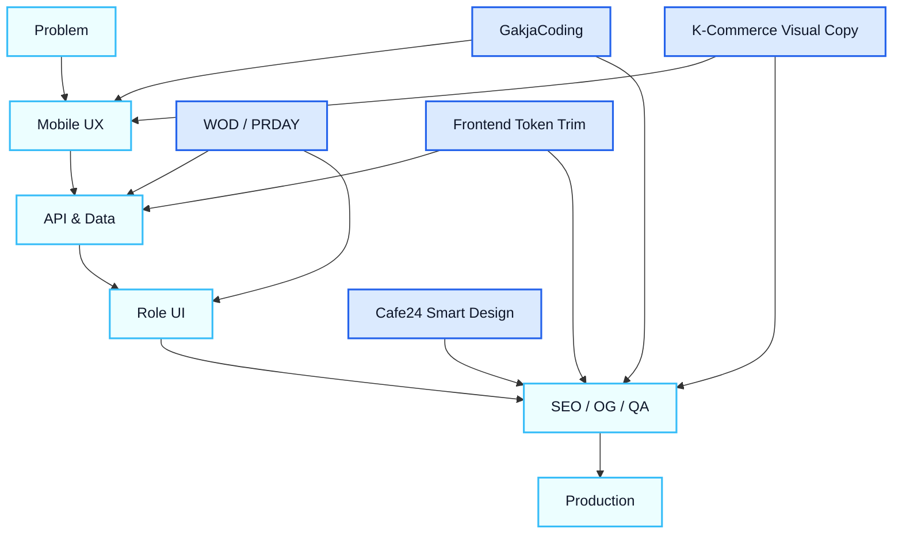

<!-- HERO -->
<p align="center">
  
</p>

<p align="center">
  <a href="https://git.io/typing-svg">
    
  </a>
</p>

<p align="center">
  <b>프론트엔드를 중심으로 제품의 구조, 흐름, 운영까지 설계합니다.</b><br/>
  <sub>Mobile-first UX · API-first architecture · Product UI · Blue Team QA</sub>
</p>

<p align="center">
  <a href="mailto:kbc01054575075@gmail.com"></a>
  <a href="https://gakjaccoding.vercel.app"></a>
  <a href="https://github.com/kimyoungwopo/cafe24-smart-design"></a>
  <a href="https://github.com/kimyoungwopo/frontend-token-trim-skillpack"></a>
  <a href="https://github.com/kimyoungwopo/korean-ecommerce-visual-copywriting-skill"></a>
</p>

<p align="center">
  
  
  
  
</p>

---

## ⚡ Currently Shipping

### 🧑‍💻 GakjaCoding

**API-first coding education/product platform**  
Next.js · Supabase 기반으로 게스트/회원 플로우, 공유 UX, GitHub avatar 기반 사용자 경험, 320/390px compact UI를 설계합니다.

[`Live App`](https://gakjaccoding.vercel.app) · `TypeScript` · `Product UI` · `SEO/OG`

---

### 🏋️ WOD / PRDAY

**CrossFit WOD, booking, coaching operations**  
회원/관리자 역할별 모바일 플로우, WOD 기록, 예약, 코칭 신청/승인 UX, 운영 데이터와 UI 상태를 연결하는 SaaS 구조를 만듭니다.

`Mobile-first SaaS` · `Role UI` · `Ops flow`

---

### 🛠️ Cafe24 Smart Design

**Frontend reference and AI-assisted workflow docs**  
Cafe24 모듈/변수/수정자 레퍼런스, 스킨 GitOps, 샘플몰 preview, AI 편집 guardrail, 정적 문서 UX를 정리합니다.

[`Repository`](https://github.com/kimyoungwopo/cafe24-smart-design) · `HTML` · `Docs UX` · `Public reference`

---

### ✂️ Frontend Token Trim Skillpack

**Hermes Agent frontend skillpack for leaner implementation context**  
Ponytail · Graphify · Headroom 기반으로 프론트엔드 작업의 컨텍스트를 좁히고, 불필요한 토큰 소비를 줄이며, QA 중심 구현 흐름을 정리합니다.

[`Repository`](https://github.com/kimyoungwopo/frontend-token-trim-skillpack) · `Hermes Agent` · `Frontend workflow` · `Skillpack`

---

### 🛍️ Korean E-commerce Visual Copywriting Skill

**Agent Skill for Korean commerce images and detail-page copy**  
스마트스토어, 쿠팡, 11번가, 오늘의집, 자사몰/SNS 광고 소재에 맞춰 대표이미지, 상세페이지 Storyboard, 이미지 내 문구, 생성형 이미지 프롬프트를 구조화합니다.

[`Repository`](https://github.com/kimyoungwopo/korean-ecommerce-visual-copywriting-skill) · `Python` · `K-commerce` · `Visual copywriting`

---

## 🧬 Live Build Signal

<p align="center">
  
</p>

---

## 🧭 Front-End Focus

**01. Product Flow**  
사용자가 어디서 들어와서, 무엇을 보고, 어떤 행동을 완료해야 하는지 먼저 설계합니다.

**02. API-first UI**  
화면만 만드는 것이 아니라 인증, 데이터 모델, API 응답, 에러/빈 상태까지 연결합니다.

**03. Mobile Blue Team**  
320/390px, 터치 타깃, 텍스트 줄바꿈, 스크롤 밀도, OG/SEO까지 실제 배포 기준으로 확인합니다.

---

## 🧩 Product Features I Build

#### 🧱 App Shell & IA
- 홈/대시보드/상세/설정으로 이어지는 정보 구조
- 모바일 하단 시트, sticky CTA, 역할별 진입 동선
- 빈 상태와 다음 행동이 보이는 화면 설계

#### 🔐 Auth & Role Flow
- 게스트, 회원, 관리자 권한 분기
- Supabase 기반 인증/프로필/권한 상태 연결
- 로그인 전후 CTA와 보호 라우트 UX

#### 📦 Data-driven Components
- 로딩, 에러, 빈 화면, 성공 상태를 포함한 컴포넌트
- API route BFF와 프론트 상태 모델 정리
- 목록/필터/상세/폼의 반복 가능한 패턴화

#### 🚀 Ship Quality
- SEO metadata, OG preview, 접근성 기본값
- Vercel 배포, GitHub workflow, 운영 체크리스트
- 모바일 overflow, touch target, visual regression 확인

---

## 🗺️ Product Map

<details>
<summary><b>제품 흐름 보기</b></summary>



</details>

---

## 🧰 Tech Stack

- **Frontend**: React, TypeScript, Next.js App Router, Vite, Tailwind CSS
- **Backend / Data**: Node.js, Express, Supabase, PostgreSQL, API route BFF
- **Product Craft**: UX flow, mobile-first IA, SEO/OG, dashboard, automation, visual QA
- **Ship**: Vercel, GitHub, Docker, Red/Blue QA gate

---

## 🛫 From Idea to Production

```txt
Problem
  ↓
User flow
  ↓
Data model / API contract
  ↓
UI states
  ↓
Mobile QA
  ↓
Deploy & iterate
```

---

## 🧠 How I Build

- 기능을 먼저 나열하지 않고 **사용자가 완료해야 하는 행동**부터 정의합니다.
- UI 컴포넌트는 **데이터 상태, 권한, 에러, 빈 화면**까지 포함해서 설계합니다.
- 모바일에서 먼저 읽히는지 보고, 데스크톱에서는 정보 구조와 밀도를 정리합니다.
- 배포 후에도 깨지지 않도록 **SEO/OG, 성능, 회귀 QA, 운영 플로우**를 함께 봅니다.

<!-- FOOTER -->
<p align="center">
  
</p>
